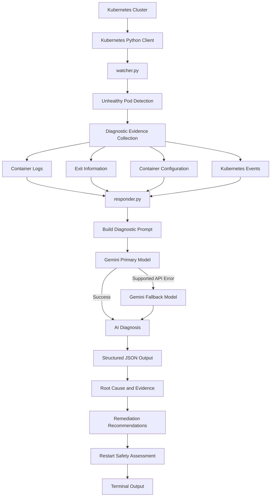

# K8s AI Responder — Architecture

## 1. System Architecture

The K8s AI Responder uses an evidence-first architecture to investigate unhealthy Kubernetes workloads.

## 2. Component Responsibilities

| Component | Responsibility |
|---|---|
| Kubernetes Cluster | Hosts containerized workloads |
| Kubernetes Python Client | Communicates with Kubernetes API |
| watcher.py | Finds unhealthy pods and collects evidence |
| responder.py | Coordinates AI diagnosis and model fallback |
| Gemini Primary Model | Performs initial incident analysis |
| Gemini Fallback Model | Handles supported primary model API failures |
| Terminal | Displays diagnostic results |

## 3. Diagnostic Workflow

### Step 1: Kubernetes Connection

The application loads Kubernetes configuration and establishes API connectivity.

### Step 2: Unhealthy Pod Detection

The watcher identifies unhealthy pods across Kubernetes namespaces.

### Step 3: Evidence Collection

The application collects:

- Container logs
- Exit information
- Container image
- Command and arguments
- Kubernetes events

### Step 4: AI Analysis

The responder builds a diagnostic prompt and sends the collected evidence to Google Gemini.

### Step 5: Fallback Handling

If the primary model encounters a supported API error, the application attempts the configured fallback model.

### Step 6: Structured Diagnosis

The AI returns a structured JSON response containing:

- Severity
- Root cause
- Evidence
- Confidence
- Remediation steps
- Safe restart recommendation
- Restart reason

### Step 7: Terminal Output

The diagnostic report is displayed to the engineer for review.

## 4. Safety Design

The application is designed as a diagnostic assistant.

It does not automatically:

- Delete Kubernetes pods.
- Modify deployments.
- Change container configurations.
- Execute remediation commands.
- Restart workloads as an automated repair action.

All recommendations are presented for human review.

## 5. Future Architecture Improvements

- Kubernetes watch-based monitoring.
- Prometheus metrics collection.
- Grafana dashboard.
- Slack and email notifications.
- Web-based incident management dashboard.
- Automated testing.
- CI/CD integration.
- Additional AI-powered troubleshooting scenarios.

---

**Project:** K8s AI Responder  
**Version:** 1.0  
**Architecture:** Python + Kubernetes API + Google Gemini AI
